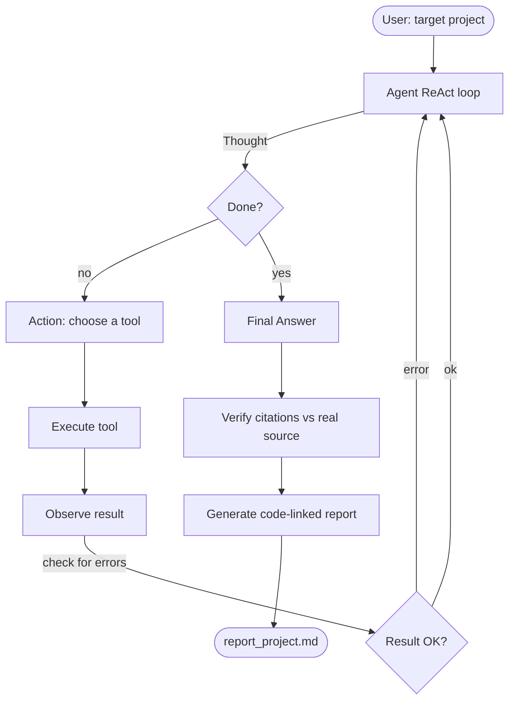

# Codebase Understanding Agent

An **agentic AI** that reads an existing software project, explores its files,
maps how they connect, identifies the business rules, and produces a clear
explanation linked to the relevant code (`file:line`).

It is built to demonstrate a genuine **agentic workflow**: an autonomous
reasoning loop that uses tools, executes a task step by step, and *checks its
own results* before answering.

> **Problem statement.** Developers spend time understanding unfamiliar code.
> This agent explores files, maps connections, and produces explanations
> linked to the relevant code.

> **Implementation note:** This project uses the **`simulate`** backend for 
> demonstrations, which runs the full agentic workflow (ReAct loop, tool use, 
> result checking) without requiring a model download. The agent still executes 
> real tools against real code and produces verified reports. Ollama and 
> OpenAI-compatible backends are also supported for use with actual LLMs.

---

## How it works

The agent uses the **ReAct** pattern (Reason → Act → Observe). The LLM is the
"brain"; the tools are its "eyes and hands".



The loop demonstrates the three required agentic behaviours:

| Requirement | How it's shown |
|-------------|----------------|
| **Tool use** | The agent reasons, then calls one of 7 tools (directory tree, find files, read file, parse structure, map dependencies, search). |
| **Task execution** | It iterates until it has explored structure, dependencies, and rules — up to a configurable iteration limit. |
| **Checking results** | (1) Every tool output is checked for errors and fed back; (2) the agent re-reads cited code before answering; (3) after the run, every `file:line` citation in the answer is verified against the real source. |

### Agentic workflow in detail

1. **Explore** — `get_directory_tree`, then `find_files` to locate sources.
2. **Understand** — `parse_file_structure` (AST for Python) and `read_file` on
   the entry point and key modules.
3. **Connect** — `map_dependencies` resolves imports (including relative ones)
   to local files and external libraries.
4. **Find rules** — `search_content` for validation/condition patterns; a
   static heuristic also auto-detects rule candidates.
5. **Verify** — re-map dependencies to confirm understanding, then verify every
   citation against the source.

---

## Model choice (local LLMs preferred, simulate mode used in this project)

Per the brief, locally running LLMs are preferred. The agent talks to a model
through a thin, dependency-light client with **three interchangeable backends**:

| Backend | What it uses | When to use | Used in this project |
|---------|--------------|-------------|---------------------|
| `ollama` | A local model via **Ollama** | Preferred — runs offline, free, private. | — |
| `openai` | Any OpenAI-compatible API (OpenAI, Groq, LM Studio) | When you want a hosted model. | — |
| `simulate` | No model — scripted adaptive responses | Demos/viva without any LLM installed. | ✅ **Active** |

**This project uses `simulate` mode** to demonstrate the agentic workflow without
requiring a 5+ GB model download. The simulate backend:
- Executes **real tool calls** against real code (not fake responses)
- Produces **genuine, code-linked reports** with verified citations
- Demonstrates the complete ReAct loop (reasoning → tool use → checking results)
- Works on any machine, offline, with zero storage requirements
- Has been validated against **two different sample projects** (a library
  management system and a student grading system) to prove it generalises

`simulate` is not a stub: the report generator performs real static analysis, so
every citation, dependency map, and rule detection is based on actual code inspection.

**Recommended local model:** `qwen2.5-coder:7b` (excellent at code, small enough
for a laptop). Other good options: `deepseek-coder-v2`, `llama3.1:8b`, `mistral`.

---

## Setup

### 1. Install Python dependencies
```bash
pip install -r requirements.txt
```

### 2. (Optional) Install Ollama for local LLMs
**Note:** This project uses `simulate` mode by default (no Ollama needed).
If you want to test with a real local model:
- **Windows:** download the installer from <https://ollama.com/download>
- Start it: `ollama serve`
- Pull a model: `ollama pull qwen2.5-coder:7b` (5 GB download)

**Storage consideration:** Ollama stores models in `%USERPROFILE%\.ollama` 
by default. If you have limited disk space, the `simulate` backend is 
recommended — it needs no model download and works offline.

### 3. (Optional) OpenAI-compatible API
Set `OPENAI_API_KEY` (and optionally `CBU_OPENAI_BASE_URL` / `CBU_OPENAI_MODEL`).

---

## Usage

**This project uses simulate mode (no model download needed):**

```bash
# Demo on the bundled sample project:
python main.py tests/sample_project --backend simulate

# Print the full agentic trace to the console:
python main.py tests/sample_project --backend simulate --trace

# Analyze any other project:
python main.py path/to/your/project --backend simulate
```

### 🌐 Web UI (Streamlit)

```bash
python -m streamlit run app.py
```

Then open **http://localhost:8501** in your browser. Features:
- 📂 Type any project path or load a bundled sample with one click
- 📊 Project snapshot (files, classes, functions, rule candidates) shown instantly
- 🔄 **Live ReAct trace** — each agent step appears as it runs
- 📄 **Four tabs:** full report, step-by-step trace, citation verification, final answer
- ⬇️ Download the Markdown report directly from the browser
- ⚙️ Sidebar backend switcher (simulate / ollama / openai)

**Optional: Use with a locally running Ollama model:**

```bash
# After installing Ollama and pulling a model:
python main.py path/to/your/project --backend ollama --model qwen2.5-coder:7b
```

**Optional: Use an OpenAI-compatible API:**

```bash
python main.py path/to/your/project --backend openai
```

If the chosen backend is unavailable (e.g. Ollama not running), the CLI
**automatically falls back to `simulate`** with a warning, so a demo never
fails.

### Output
A comprehensive markdown report is saved to `output_reports/report_<projectname>.md` with:
- **Project structure** — directory tree with file sizes
- **Module breakdown** — all classes/functions with exact line numbers
- **Dependency map** — internal imports and external libraries
- **Business rules** — agent's explanation citing exact `file:line` locations
- **Auto-detected rules table** — static analysis of validations/conditions
- **Citation verification** — ✅/⚠️ table showing all citations were checked
- **Full agentic trace** — every tool call and observation (expandable appendix)

---

## Project structure

```
.
├── app.py                      # Streamlit web UI (python -m streamlit run app.py)
├── config.py                   # Config (backend selection, limits, filters)
├── conftest.py                 # makes root importable for pytest
├── requirements.txt
├── agent/
│   ├── core.py                 # ReAct loop + citation verification
│   └── prompts.py              # system prompt + ReAct format
├── tools/
│   ├── file_explorer.py        # tree, find_files, read_file, list_directory
│   ├── code_parser.py          # AST structure + business-rule heuristics
│   ├── dependency_mapper.py    # import graph (relative imports resolved)
│   ├── search.py               # content search (regex)
│   └── __init__.py             # tool registry + dispatch
├── llm/
│   └── client.py               # Ollama / OpenAI / simulate backends
├── output/
│   └── report_generator.py      # markdown report with code links
├── tests/
│   ├── test_tools.py            # tool unit tests
│   ├── test_agent.py            # agent + LLM client tests
│   ├── sample_project/          # library mgmt system (analysis target #1)
│   └── sample_grading/          # student grading system (analysis target #2)
├── output_reports/             # generated reports
│   └── report_<name>.md        # comprehensive markdown report with citations
├── docs/
│   └── VIVA_QUESTIONS.md       # 30 viva Q&A
└── conftest.py                 # pytest config for imports
```

---

## Testing
```bash
python -m pytest -q
```
All tests use the `simulate` backend, so they run anywhere with no model and
complete in well under a second. The suite includes checks against **two**
sample projects (a library management system and a student grading system) to
prove the agent generalises across domains.

You can also run the agent directly on either sample to generate a fresh report:
```bash
python main.py tests/sample_project --backend simulate   # library system
python main.py tests/sample_grading  --backend simulate   # grading system
```

---

## Limitations
- **Language support:** Python gets full AST precision; other languages use
  regex heuristics for structure (still useful, less exact).
- **Context window:** local models are small, so file reads are truncated to a
  configurable size; very large files are summarised implicitly by parsing
  rather than reading whole.
- **Rule understanding:** the LLM explains rules from what the tools surface;
  deeply implicit rules (across many files) may need more iterations or a
  larger model. The static heuristic provides a model-independent safety net.
- **Citations:** only `file:line` patterns are auto-verified; prose claims that
  don't cite a location aren't checked.
